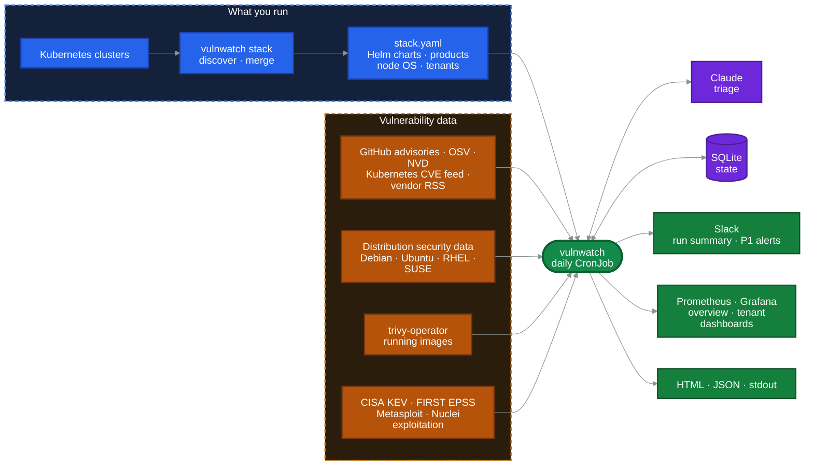

<p align="center">
  <picture>
    <source media="(prefers-color-scheme: dark)" srcset="logo/logo-dark.svg">
    
  </picture>
</p>

<p align="center"><em>The daily sweep for vulnerabilities in what you run</em></p>

<p align="center">
  <a href="#quick-start">Quick start</a> ·
  <a href="#documentation">Documentation</a> ·
  <a href="ROADMAP.md">Roadmap</a> ·
  <a href="CONTRIBUTING.md">Contributing</a>
</p>

<p align="center">
  <a href="https://github.com/vasops/vulnwatch/actions/workflows/ci.yml"></a>
  <a href="https://github.com/vasops/vulnwatch/releases"></a>
  <a href="https://artifacthub.io/packages/search?repo=vulnwatch"></a>
  <a href="LICENSE"></a>
  
</p>

---

**vulnwatch** runs once a day and answers one question: *which vulnerabilities
affect the products and versions we run, and what should we do about them?*

You describe what you run in one `stack.yaml`, or generate it from your
clusters. vulnwatch checks the right advisory sources for each product,
confirms what really runs with Trivy, adds exploitation data, matches every
advisory against your versions and lets Claude explain what's new in plain
words. You get a short Slack message, Grafana dashboards and an action for
every finding.



## Why vulnwatch

Scanners list everything that could be wrong. vulnwatch tells a platform team
what to patch today.

- **Starts from what you run.** One `stack.yaml`, generated from the cluster,
  covers Helm charts, images, the Kubernetes distribution, the nodes' kernel
  and software outside the cluster (GitLab, toolchains).
- **Right source per product.** Vendor advisories, OSV, NVD, the Kubernetes
  CVE feed and vendor RSS report issues before patched images exist; Trivy
  confirms what actually runs.
- **Few alerts, prioritised.** Only new or materially changed findings.
  Claude weighs the version match, exposure, criticality, KEV, public exploits (Metasploit, Nuclei), CISA's SSVC
  and EPSS and explains the priority; rules set a floor and stand in without Claude, so
  thousands of image and kernel CVEs shrink to the handful that matter.
- **Every finding comes with an action.** What to upgrade to, and per product
  the one version that fixes everything open.
- **One instance, many tenants.** Customers, organizations or teams, each with
  its environments, Slack channels and dashboard; advisories are fetched once
  for all of them.
- **Small to run.** One binary with its defaults built in, one CronJob, SQLite
  state, Slack and Prometheus. No database server, no UI to operate.

It is not a vulnerability management platform: no ticketing, SLAs or
compliance reports. For those, feed a tool such as OWASP Dependency-Track or
DefectDojo. What could come next is in the [roadmap](ROADMAP.md).

## Quick start

### On your machine

Download a binary from the [releases](https://github.com/vasops/vulnwatch/releases)
(linux/amd64, darwin/arm64) or build it with `make build`.

```sh
vulnwatch stack discover -o stack.yaml       # what runs in the current kubeconfig context
export STACK_CONFIG=stack.yaml               # or start from examples/stack.yaml
export GITHUB_TOKEN=...                      # recommended (60 requests/hour without)

vulnwatch validate-config                    # check the stack, show what each product resolves to
vulnwatch audit --product keycloak           # what affects the version you run (full history, no Claude)
```

A full run needs Claude for triage (`ANTHROPIC_API_KEY`). Without it, switch
triage off and priorities are rule-based:

```sh
echo 'triage: {enabled: false}' > notriage.yaml
vulnwatch run --dry-run --app-config notriage.yaml   # no state written, nothing posted
```

### In Kubernetes

The Helm chart runs vulnwatch as a daily CronJob with its state on a PVC:

```sh
helm install vulnwatch oci://ghcr.io/vasops/charts/vulnwatch \
  --version <version> -n vulnwatch --create-namespace -f values.yaml
```

```yaml
# values.yaml
stack:                                    # your stack.yaml
  products:
    keycloak: { version: "26.7.0", exposure: internet, criticality: high }
secrets: { existingSecret: vulnwatch-envs }   # ANTHROPIC_API_KEY, GITHUB_TOKEN, SLACK_BOT_TOKEN, ...
run: { outputs: [stdout, slack] }
env: { SLACK_CHANNEL: C0123456789 }
```

See the [chart README](charts/vulnwatch/README.md) for Slack, metrics,
dashboards, Trivy and Argo CD, and [Deployment](docs/deployment.md) for
Docker.

## Your stack in one file

`stack.yaml` lists what you run: product names and version constraints.
vulnwatch knows where to look for each product (`vulnwatch catalog list`).

```yaml
helm:                    # charts you deploy: versions are read from the chart
  - { repo: https://argoproj.github.io/argo-helm, chart: argo-cd, version: 10.9.7 }

os:                      # the nodes: their kernel is watched too
  name: debian
  release: "13"
  kernel: "6.12.48"

products:                # everything else
  postgresql: "17.4"
  kubernetes: ">=1.33.0"
  keycloak: { version: "26.7.0", exposure: internet, criticality: high }
```

`vulnwatch stack discover` writes this file from a cluster and
`vulnwatch stack merge` keeps it up to date. A longer example is in
[`examples/stack.yaml`](examples/stack.yaml); every option is in
[Configuration](docs/configuration.md).

## Documentation

| Topic                                  | What is in it                                                                                    |
| -------------------------------------- | ------------------------------------------------------------------------------------------------ |
| [How it works](docs/how-it-works.md)   | a run step by step, sources, version matching, node kernel, Trivy, known limitations             |
| [Configuration](docs/configuration.md) | `stack.yaml`, generating it from a cluster, `config.yaml`, `sources.yaml`, environment variables |
| [Tenants](docs/tenants.md)             | customers, organizations or teams with their own environments, channels and dashboards           |
| [Commands and logging](docs/cli.md)    | every command and flag, log levels, the audit log                                                |
| [Outputs and metrics](docs/outputs.md) | Slack, HTML, JSON, Prometheus metrics, Grafana dashboards, alerts                                |
| [Deployment](docs/deployment.md)       | Docker; Kubernetes is in the [chart README](charts/vulnwatch/README.md)                          |
| [Security](docs/security.md)           | how vulnwatch is hardened, verifying release signatures                                          |
| [Threat model](docs/threat-model.md)   | what can go wrong and what stops it                                                              |
| [Development](docs/development.md)     | building, testing, adding a product, releasing                                                   |
| [Roadmap](ROADMAP.md)                  | ideas for what could come next                                                                   |

## Security

vulnwatch reads untrusted data all day and holds API tokens, so it is built
to assume something goes wrong: advisory text can't talk triage down, the
process is sandboxed with Landlock, and the image is distroless and
non-root. Release images, charts and binaries are signed with cosign. See
[Security](docs/security.md).

Found a vulnerability in vulnwatch itself? Report it privately, see
[`SECURITY.md`](SECURITY.md).

## Contributing

Issues and pull requests are welcome. [`CONTRIBUTING.md`](CONTRIBUTING.md)
has the development setup and the conventions.

## Contributors

<a href="https://github.com/vasops/vulnwatch/graphs/contributors">
  
</a>

## License

[Apache License 2.0](LICENSE)
