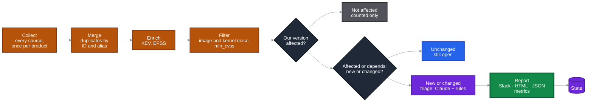
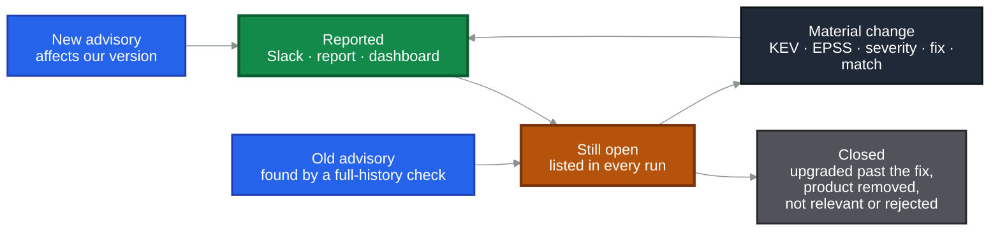

# How it works



## A run, step by step

1. **Window:** everything changed since the last successful run (minus
   `run.overlap`, 24h). A source that failed keeps its own window start: the
   next run asks it again from there, so nothing it missed is lost, while
   the run and the other sources move on.
2. **Collect:** every source is asked about every product, once, however many
   tenants run it. A source that failed is asked once more after
   `run.retry_failed_after` (3m), which rides out a feed's short outage (NVD
   answers 503 now and then). Only a source that fails again counts as
   failed: it never fails the run, it becomes a warning, and
   `VulnwatchSourceFailing` fires when it keeps failing for a day.
   NVD gets at most `sources.nvd.max_in_flight` (2) requests at once and
   `sources.nvd.timeout` (90s) per request: when busy, it answers slowly and
   turns parallel requests away. `sources.nvd.budget` (10m) caps its time
   per run, so a slow NVD can't use up `run.deadline`; what is left is asked
   next run.
3. **Full-history check:** when a product is new (or back after removal from
   the stack), or its version or catalog entry changed, it is checked against
   *every* advisory ever published. Old
   advisories go straight to **Still open** without being reported as new (no
   flood, no Claude cost). The first run does this for all products, and so
   does the first run of a release that reads advisories differently
   ("matching updated"): the daily window never fetches old advisories again,
   so only this re-check corrects findings stored with the old reading.
4. **Match:** each advisory is compared with the version you run (see
   [Version matching](#version-matching)).
5. **New or changed:** a finding is reported once when new, and again only on
   a material change: higher severity, added to KEV, an EPSS that rose from
   below 0.1 to 0.1 or above, a new fixed version or a different match.
6. **min_cvss:** findings below the product's threshold are counted, not
   listed. KEV-listed findings are always kept.
7. **Triage:** Claude returns whether it's relevant, a priority (P1 act today,
   P2 this week, P3 next maintenance, P4 informational), a plain-language
   summary and the action. Invalid answers are retried once; after that, or
   above `triage.max_findings`, a rule-based priority is used and marked *not
   triaged*, and a later run with budget left asks Claude again (without
   reporting it again). After a failed API call (retried once) the run sends
   Claude nothing more. Failed calls are counted
   (`vulnwatch_triage_failures`, alert `VulnwatchTriageFailing`) and the Slack
   summary says priorities are rule-based; a run in which Claude answered
   nothing (a bad API key or model name) fails after reporting. When a
   product's exposure or criticality changes, a
   still-open finding gets the more urgent of Claude's priority and the
   rules' priority now. The rules weigh KEV, CVSS, exposure and criticality;
   CISA's SSVC exploitation "active" counts like KEV on internet-facing or
   high-criticality products; EPSS ≥ 0.1 only raises a priority (a rise across
   0.1 is reported again as "EPSS rose to 82% (from 1%)", so the priority
   follows); and unless exploited, a finding that may not affect your version
   (match unknown) is at most P2.

   **What triage costs:** a run sends about `max_findings / batch_size`
   batches (one more when findings owed from earlier runs are retried in the
   same run), each sent at most twice; with the defaults that is 5 or 6
   batches. `vulnwatch_triage_requests` and `vulnwatch_triage_tokens`
   give the requests and tokens of the last run. Cost is tokens times the
   price of your model, for example
   `vulnwatch_triage_tokens{type="input"} * <input price per token> + ...`
   with one term per token type.
8. **Report and state:** outputs render, then the state is written. It is
   written only if every output succeeded, so a failed Slack post is reported
   again next time (at-least-once: channels that worked may get it twice).
   The state DB carries a schema version: a newer vulnwatch migrates an older
   DB in place, an older one refuses a newer DB instead of misreading it (to
   roll back, restore a copy from before the upgrade or start a fresh DB).

A finding's life:



### Closed findings

Every run records which stored findings it lists as open (still open, new,
updated, and the ones only counted because they can't be tracked). A finding
that was open in an earlier run and is not open now is recorded as closed,
with the time and a reason; the weekly report
([Slack](outputs.md#outputs)) lists the closures of its week.

| Reason         | When                                                                                                   |
| -------------- | ------------------------------------------------------------------------------------------------------ |
| `fixed`        | the version we run no longer matches, or an image-only finding's image no longer runs (Trivy answered) |
| `removed`      | the product or its tenant environment is no longer in the stack                                        |
| `rejected`     | the CVE list rejected all its CVE IDs                                                                  |
| `not-relevant` | any other way it left the open list: triaged not relevant, or below `min_cvss`                         |

- A finding open again (a downgrade, a product added back) loses its closure.
- A finding that was never listed as open is never closed.
- Nothing is closed in a dry run, in a run limited with `--product` (the
  other products would look removed), or in a run that fails before writing
  the state. While the image source fails, image-only findings stay open.
- Tracking starts with the first run of the version that has it: findings
  stored before have no open record, so nothing is closed in that first run
  and closures from before the upgrade are not known.
- A closed finding keeps the tenant and environment it ran in, also when the
  environment left the stack; its weekly entry then goes to the default
  channel.

## Sources

| Source                                                  | Used for                                                                                                                                           | Auth                       |
| ------------------------------------------------------- | -------------------------------------------------------------------------------------------------------------------------------------------------- | -------------------------- |
| GitHub repository security advisories                   | advisories published in the product's repo                                                                                                         | `GITHUB_TOKEN` (optional)  |
| OSV.dev                                                 | package advisories, incl. the GitHub Advisory Database                                                                                             | none                       |
| CVE records (cvelistV5)                                 | the CNA's own affected versions from day 0, with CISA Vulnrichment (CVSS, CPEs, SSVC); matched by CNA vendor/product names, CPEs and package names | `GITHUB_TOKEN` (optional)  |
| NVD CVE API 2.0                                         | CVEs by CPE                                                                                                                                        | `NVD_API_KEY` (optional)   |
| Kubernetes official CVE feed                            | `kubernetes`, `rke2`                                                                                                                               | none                       |
| RSS/Atom                                                | vendors without an API (GitLab, Drupal)                                                                                                            | none                       |
| CISA KEV (GitHub copy)                                  | exploited in the wild                                                                                                                              | none                       |
| FIRST EPSS                                              | probability of exploitation                                                                                                                        | none                       |
| Red Hat Security Data API                               | Red Hat's rating and statement (when a flaw is exploitable) for CVEs already found; context for triage and the P1 card                             | none                       |
| trivy-operator VulnerabilityReports                     | vulnerable packages in the running images (off by default)                                                                                         | in-cluster service account |
| Distribution security data via OSV                      | the nodes' kernel (`os:` in stack.yaml): Debian, Ubuntu, RHEL, Rocky Linux, AlmaLinux, SUSE, openSUSE Leap                                         | none                       |
| Red Hat Security Bulletins, CERT-EU Security Advisories | `vulnwatch news` only, see [Security news](#security-news)                                                                                         | none                       |

## Security news

The sources above find advisories for the products we run. A flaw in
something inside many of them (the JDK in a Keycloak image, a library in
every web server) is often in the news hours or days before an advisory
names one of our products: Java4Shell (CVE-2026-114938) was filed by Oracle
for "Oracle Java SE" only, and Keycloak's own post was the first to say
Keycloak was affected.

`vulnwatch news` (the chart's `news.enabled`, hourly) reads a few security
news feeds where those flaws show up (`sources.news`) and posts each new
item once to `SLACK_NEWS_CHANNEL` (else `SLACK_CHANNEL`), with the stack
products its title names (catalog name or alias as a whole word, at least
three letters; the nodes' kernel by "kernel") and where they run:

> :newspaper: **RHSB-2026-018 Remote Code Execution via memory corruption on x86-64 systems - OpenJDK (CVE-2026-114938) - "java4shell"**
> _Red Hat Security Bulletins_ · CVE-2026-114938
> :round_pushpin: **Runs here:** **java** (acme: infra, prod; vasops: prod)

| Feed                                        | What                                                                                                                                                       |
| ------------------------------------------- | ---------------------------------------------------------------------------------------------------------------------------------------------------------- |
| Red Hat Security Bulletins (`format: rhsb`) | a few a year, only for flaws with industry-wide impact (Log4Shell, regreSSHion, XZ, Java4Shell); read from the list page, which has no feed                |
| CERT-EU Security Advisories (`format: rss`) | two or three a month, only for critical and high-impact flaws (Java4Shell, NetScaler, GitLab); not CISA's alerts: cisa.gov answers cloud IPs with HTTP 403 |

Items are not matched by version and don't become findings: an advisory
for the product is still reported by the daily run. A feed read for the
first time is only remembered, so nothing already there is posted; feeds
are keyed by `name`. What was posted is kept in the state DB (the chart
gives the news CronJob its own volume). Add a feed with `format: rss` for
any RSS or Atom feed.

To see the first messages in the channel, `--repost N` (the chart's
`news.repost`) posts the newest N items of each feed again on every check,
posted before or not. Set it back to 0 afterwards.

## Version matching

Every advisory is matched against the version you run:

- **affected:** every version your constraint allows is in an affected range.
- **not affected:** none is; counted, never listed or sent to Claude.
- **depends on exact version:** the constraint only partly overlaps (`26.x`
  vs `< 26.1.4`), or it is `*`. Use exact versions for firm answers. Also
  when the advisory limits the range to a platform (NVD: only on Windows).
- **no version data:** the advisory gives no versions (RSS, the Kubernetes
  feed, NVD records without bounds), or a repository advisory covers several
  packages with different versions (a server and its UI), so it can't tell
  which one you run. New ones are reported and triaged; old ones found by a
  full-history check are only counted.

Sources disagree often; vulnwatch prefers the most precise data (a range with
a fix over an open-ended one starting at the same version) and ignores junk
such as `N/A` or Go pseudo-versions. A range it cannot parse makes the match
"depends on exact version" unless another range of the same source covers
the version.

Each source's ranges are matched on their own. When every source with
version data agrees, that is the match; when they disagree, it is "depends
on exact version", naming each source's verdict (`ghsa: affected (>=1.18.0
<1.40.0); nvd: not affected`). So one source's coarse range can't keep a
version that another source's per-branch ranges list as fixed affected.

## Node kernel

With an `os:` section in stack.yaml, vulnwatch watches the kernel the nodes
run as a product named after the OS, such as `debian-13-kernel` or
`rhel-9.4-kernel`. It asks OSV for the distribution's security data (Debian
and Ubuntu trackers, RHSA/RLSA/ALSA, SUSE-SU) with each running version, and
makes one finding per CVE that the release already fixed. The trackers list
thousands of kernel fixes per release, so only the KEV-listed ones and those
with EPSS ≥ `sources.os.min_epss` are reported: on a Debian 13 cluster that is
3 out of about 5000. The upgrade target is the kernel package to install;
nodes on different kernels show up as a union (`6.12.48 || 6.12.62`), and
only the old ones are affected.

```yaml
os:
  name: debian            # debian, ubuntu, rhel, rocky, almalinux, sles, opensuse-leap
  release: "13"
  kernel: "6.12.48 || 6.12.62"
  criticality: high       # every workload runs on the nodes
```

`stack discover` and `stack merge` fill it in from the nodes (`osImage`,
`kernelVersion`). Only the kernel is watched, not every OS package: the
Kubernetes API doesn't say which packages a node has. Debian 12 kernels
(`6.1.0-28-cloud-amd64`) don't show their package version; set `kernel` by
hand there (`dpkg -l 'linux-image*'`).

## Image findings (Trivy)

Advisories say what affects a product *version*; Trivy says what is inside the
*running images* (OS packages, libraries, Go binaries). With `trivy.enabled` in
the Helm chart, vulnwatch reads trivy-operator's VulnerabilityReports from the
cluster it runs in and attaches each image to a product by the catalog's
`images:`. It only works in-cluster (the pod's service account).

| Seen by               | Means                                                   | Handling                                                                                                                                                                      |
| --------------------- | ------------------------------------------------------- | ----------------------------------------------------------------------------------------------------------------------------------------------------------------------------- |
| an advisory and Trivy | the vulnerable code is confirmed running                | **affected**, priority raised (CVSS ≥ 7 is at least P2)                                                                                                                       |
| an advisory only      | as before                                               | version matching                                                                                                                                                              |
| Trivy only            | a package inside the image, no advisory for the product | reported only if a fixed package exists **and** it is KEV-listed, has EPSS ≥ `min_epss`, or is at least `min_severity` (`min_severity_internet` for internet-facing products) |

Trivy is the scanner, vulnwatch decides what matters: image findings go
through the same KEV/EPSS enrichment, new-only reporting, triage, Slack and
metrics, and the advice is a newer image rather than a package upgrade. An
image finding stays **Still open** exactly while Trivy still finds it. When
Trivy is turned on, or a product is re-checked, its current image findings are
recorded as history and listed under Still open instead of being reported as
new. Images no product claims are listed at the end of the report: add them to
the catalog with `images:` (`stack discover` shows which).

```yaml
# sources.yaml (built-in values; the chart's trivy.enabled sets enabled)
sources:
  trivy:
    enabled: false
    min_severity: critical
    min_severity_internet: high
    min_epss: 0.1           # 0 turns the EPSS rule off
```

## Known limitations

- RSS posts and the Kubernetes feed carry no version data, so their findings
  are only counted.
- NVD records that mark a product vulnerable without any version bounds are
  treated as "no version data" when no other source has ranges.
- Ranges are only as good as the advisories. For example, the GitHub advisory
  for CVE-2026-16443 says `< 26.37.1` where it means `< 26.7.1`. Report such
  errors upstream.
- Still-open findings use the data stored when they were last reported; a later
  change outside the window (e.g. a new fixed version) isn't picked up. KEV
  and EPSS are the exceptions: every run checks open findings against the KEV
  catalog. When the catalog can't be downloaded, the last cached copy is used.
  The EPSS re-check covers open findings that have a CVE ID and are not
  KEV-listed. It reports only a rise from below 0.1 to 0.1 or above; other
  rises and falls are not reported, and the open list keeps showing the EPSS
  from the last report. When the EPSS source fails, nothing is reported for
  EPSS, and when FIRST cannot be reached, findings keep the EPSS stored with
  their last report. When a product gets a full-history check, the current EPSS of its
  older findings is recorded without a report.
- Some products have no CPE in NVD (NetBird), so NVD can't find them.
- `stack discover` reads versions from image tags. Images pinned only by
  digest, or tagged `latest`, are listed without a version; exposure only
  means "behind an Ingress, route or LoadBalancer", not whether that is public.
- Image findings need trivy-operator in the cluster vulnwatch runs in, and
  only cover what runs there: tenants get advisory and kernel findings, not
  image findings. `audit` leaves them out (it answers "what affects version
  X"). Trivy-only findings without a fixed package are never reported.
