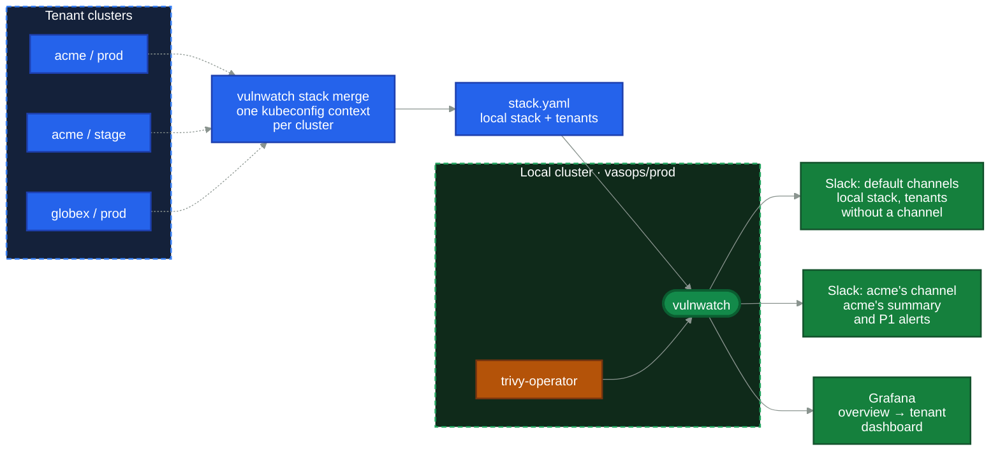

# Tenants

One vulnwatch can watch the stacks of several customers, organizations or
teams. The top level of stack.yaml is the **local** stack: the cluster
vulnwatch runs in, the only one Trivy reads. Every other stack is a tenant's
**environment**, built from its cluster with `stack merge`:



```yaml
tenant: vasops           # how the local stack is named (default local/default)
environment: prod
defaults: { min_cvss: 4.0 }          # for every tenant
products: { keycloak: "26.7.0" }     # the local stack, as above

tenants:
  acme:
    defaults: { exposure: internet } # for all of acme's environments
    slack: { channel: C0ACME }       # acme's summary and P1 alerts go here
    environments:
      prod:
        generated_at: "2026-11-02"              # written by stack merge
        slack: { alert_channel: C0ACMEALERTS }  # this environment's P1 alerts
        helm: [ ... ]
        products: { keycloak: "25.0.6" }
        os: { name: rhel, release: "9.4", kernel: "5.14.0-427.13.1.el9_4" }
      stage:
        products: { keycloak: "26.0.1" }
  globex:
    environments:
      prod: { products: { gitlab-ce: "19.5.3" } }
```

One CLI with a kubeconfig context per cluster builds the whole file.
`stack merge` adds a tenant or environment the file doesn't have yet:

```sh
vulnwatch stack merge stack.yaml                                                # the local cluster
vulnwatch stack merge stack.yaml --context acme-prod  --tenant acme   --environment prod
vulnwatch stack merge stack.yaml --context acme-stage --tenant acme   --environment stage
vulnwatch stack merge stack.yaml --context globex     --tenant globex --environment prod
vulnwatch stack diff --context acme-prod --tenant acme --environment prod       # drift check
```

`stack discover --tenant acme --environment prod` writes a new file with the
stack nested under `tenants.acme.environments.prod`.

- **Same sections everywhere.** Each environment has `helm`, `products` and
  `os`. Defaults layer: stack.yaml, then the tenant's, then the
  environment's, then the product's own settings.
- **Fetched once.** Advisories are fetched once per product, however many
  tenants run it, and matched against each tenant's versions. Claude triages
  a finding once for all tenants that run the same version with the same
  exposure and criticality.
- **Named everywhere.** Findings, state, Slack messages, metrics, alerts and
  dashboards carry the tenant and environment; reports say `acme/prod
  keycloak`.
- **Slack routing.** A tenant or environment with its own `channel` gets its
  own run summary and P1 alerts there (in `alert_channel`, else the same
  channel), with a dashboard link that selects the tenant. The local stack and
  tenants without channels use `SLACK_CHANNEL` / `SLACK_ALERT_CHANNEL`, which
  also get the run's warning count. Every channel is told when a source
  failed (by name only).
- **Trivy is local.** Image findings belong to the local stack only. A
  tenant's kernel is watched from its `os` section, like the local one.
- **Compatible.** A stack.yaml without `tenants` is one tenant, `local/default`.
  State written before tenants existed stays valid for the local stack.
